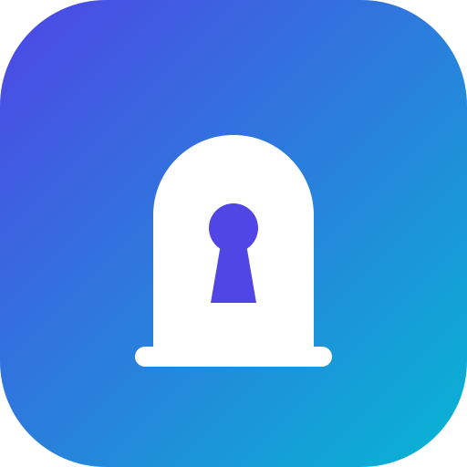

<p align="center">
  
</p>

# homebridge-intratone

Homebridge dynamic-platform plugin that opens **Intratone / Cogelec** doors and gates from
HomeKit and Matter, using the same REST calls as the official app. Every door your account can
open over the API (`data`/4G mobipass and `ble` modes) becomes a HomeKit lock (or garage door)
and, on a bridge with Matter enabled, a Matter door lock for Google Home, Alexa, SmartThings or
Apple Home.

Phase 1 covers remote opening only. Doorbell, video and two-way audio (SIP + FCM) are not
implemented.

> **Unofficial.** This plugin is not affiliated with or endorsed by Intratone or Cogelec. It
> talks to the private API of their app, which can change or stop working at any time.

## How it works

- Registers as a device with `POST /api/auth/device` and keeps the 7-day JWT fresh. It checks
  every 12 h, refreshes when less than a day is left, and refreshes once on a refused call.
  Concurrent callers share a single refresh.
- Lists doors with `GET /api/access` at startup and then every hour (configurable). Doors are
  added and removed as residences change. An empty list never removes existing doors, so a
  server hiccup can't wipe your HomeKit rooms and automations.
- Opens with `POST /api/access/open/clemobil` (`phonenumber`, `access_id`). This endpoint also
  handles `data` and `ble` doors.
- `clemobil` (2G) doors are skipped. The app opens those by placing a GSM call, which a server
  can't do.
- The open is a stateless pulse with no real door state to read. A lock shows **Unlocked** for
  `pulse_seconds`, then returns to **Locked**. A failed open goes straight back to Locked and
  logs the HTTP status and body.
- On HTTP 429 the plugin backs off, honouring `Retry-After` or else waiting 1 min, doubling up
  to 15 min, and sends nothing during the backoff.

## Install

In the Homebridge UI, open **Plugins**, search for **homebridge-intratone** (the full name) and
click **Install**. This works the same in the official `homebridge/homebridge` Docker image
(Synology, Unraid, …). A search for just "intratone" may not list it yet: the UI shows the 99
best-ranked Homebridge plugins for a word, and npm ranks new packages low.

Without the UI:

```bash
npm install -g homebridge-intratone
```

Then, in the plugin settings:

1. Enter your Intratone account **phone number** — the only required setting.
2. **Set up the door key** under *Door key*. Homebridge is a new device, so this is two quick
   steps, each a code texted to your number: **Pair this device** (4-digit code — registers
   Homebridge with your account, doesn't affect your phone), then **Claim the door key** (6-digit
   code — moves the 4G key from the phone that holds it now). See [Mobipass](#mobipass-the-door-key).
3. Enable **child bridge** for the plugin (*Bridge Settings*), so a fault here can't take the
   main bridge down, and restart it.

Everything else has a sensible default (see below).

### Configuration

```json
{
  "platform": "Intratone",
  "name": "Intratone",
  "tel": "0612345678",
  "indicatif": "33",
  "service": "garage",
  "_bridge": { "username": "0E:9A:…", "port": 51830 }
}
```

| key                      | default  | notes |
| ------------------------ | -------- | ----- |
| `tel`                    | required | Phone number of the Intratone account — the only required setting. National (`06…`) or international (`+33 6…`). Several spellings are tried, and the one that works is remembered. |
| `app_token`              | built in | The iOS app's embedded secret, the same on every iPhone, shipped with the plugin. Set it only to override it if it ever stops working, or with `user_agent: android` (not known). See [Updating the built-in token](#updating-the-built-in-token). |
| `app_id`                 | built in | Names the official app, not your account (`app_apisip_ios`), shipped with the plugin. Set it only with `user_agent: android`. |
| `indicatif`              | `33`     | Country code. |
| `device_id`              | generated | Homebridge's own device identity: generated once and reused forever (the settings page shows it and can regenerate it). A new device must claim the door key. Advanced: set it to your phone's device id (from a capture) to share the phone's key instead. |
| `service`                | `garage` | `garage` (GarageDoorOpener, default) or `lock` (LockMechanism). HomeKit only; over Matter every door is a lock. |
| `pulse_seconds`          | `30`     | How long a door shows as unlocked/open after a successful open. 30 s suits an exterior gate; 1–60. |
| `access_names`           | –        | Rename doors: a list of `{ "access_id": "…", "name": "…" }`. Easier from the settings page (below). Unnamed doors keep their detected names. |
| `access_refresh_minutes` | `60`     | How often the door list is re-fetched. |
| `user_agent`             | `ios`    | `ios` or `android` client identity. |
| `app_version`            | `4.6.4`  | `appversion` sent at login. |
| `debug`                  | `false`  | Logs every request and response at info level, plus the raw door list once at startup. Tokens, app credentials and your phone number are masked. |

### Settings page

The plugin's settings screen talks to Intratone directly. From top to bottom:

- **Account** — country code, phone number and the HomeKit service.
- **This device** — the **Device ID** Homebridge uses with Intratone, with a *Regenerate* button.
  Regenerating makes Homebridge a new device, so the door key below has to be claimed again — the
  pairing steps then appear right underneath.
- **Door key** — whether Homebridge holds the 4G key. A new device shows two **required** steps,
  each *Send SMS code → type the code → Confirm*: **Pair this device** (4-digit, registers it) and
  then **Claim the door key** (6-digit, moves the key to it). The settings are saved automatically
  once the key is claimed; restart the child bridge so the doors appear in HomeKit.
- **Your doors** — the detected doors, each with a field to rename it in the Home app.
- **Advanced** — name, pulse duration, refresh interval, client identity, app version, app ID and
  app token (both built in), debug.

The plugin keeps `device_id` and the current JWT in
`<homebridge storage>/intratone/<hash>.json` (mode 0600). Delete that file only if you want to
register as a new device.

### Matter

Needs Homebridge 2. In the plugin settings, open *Bridge Settings*, tick **Enable Matter**,
pick a free Matter port, save and restart the child bridge. The Matter QR code and pairing code
then appear in the same *Bridge Settings* dialog; scan them from Google Home, Alexa, SmartThings
or any other Matter controller. Several controllers can share the same pairing.

- Every door becomes a Matter **door lock**, whatever `service` is set to: Matter controllers
  have no gate opener. *Unlock* opens the door; it shows unlocked for `pulse_seconds`, then
  locked again. A failed open is reported to the controller as an error.
- HomeKit keeps working on the same bridge. Pairing the Matter bridge into Apple Home as well
  would show every door twice, so use Matter for the other ecosystems, or turn HomeKit off for
  this bridge if you only want Matter.
- Some controllers restrict unlocking a door lock by voice, or ask for a PIN that this plugin
  doesn't provide. Unlocking from the controller's app is unaffected.
- Homebridge's Matter support is experimental and not CSA certified, so controllers may warn
  about an uncertified accessory while pairing.

### Updating the built-in token

The iOS `app_token` is shipped with the plugin, so you normally never touch it. It is the
official app's embedded secret: if Intratone ever changes it, every install stops signing in at
once and the log shows an authentication error. The fix is to read the current token from your
own phone, set it in **App token** to get going again, and update once a new plugin release
ships with the new value.

`app_token` travels only in the sign-in request (`POST /api/auth/device`). Capture it on the
iPhone itself with [Proxyman for iOS](https://proxyman.com/ios); no computer is needed:

1. Install **Proxyman**, allow the VPN it adds, generate its certificate, install the profile
   in **Settings → General → VPN & Device Management**, and trust it in **Settings → General →
   About → Certificate Trust Settings**. Start the VPN.
2. Open Intratone once, switch to Proxyman, tap the **sip.intratone.info** domain and a request
   in it, then **Enable SSL Proxying** for that domain.
3. Delete and reinstall Intratone and sign in — a fresh install always signs in. In Proxyman,
   open **POST /api/auth/device** and copy `app_token` from the request body into **App token**.
4. Stop the VPN, delete the capture, and remove the Proxyman profile in **Settings → General →
   VPN & Device Management**. A trusted certificate left installed weakens your HTTPS security.

The same request's body also carries `device_id`. Copying it into **Device ID** (the *This device*
section) makes Homebridge act as that iPhone and share its door key, so you can skip the
mobipass transfer below. Already have an HTTPS proxy on a computer, such as
[mitmproxy](https://mitmproxy.org/)? Route the iPhone through it and read the same request. A
capture holds a live session token and your phone number — keep it private.

## Mobipass: the door key

Mobipass is single-owner: the key that opens `data` (4G) doors lives on one device at a time.
Homebridge is its own device, so on a first install — and after regenerating the device ID — it
must register with your account and then take the key.

### Setting up the key (the normal setup)

A device the server has never seen is rejected (`DEVICE_INVALID`) until it registers, so the
settings do this in two steps under **Door key**, each a code texted to the account phone:

1. **Pair this device** — *Send SMS code → type the 4-digit code → Confirm*. This registers
   Homebridge with your account (`auth/register` + `auth/validate`). It does **not** touch your
   phone.
2. **Claim the door key** — *Send SMS code → type the 6-digit code → Confirm*. This moves the 4G
   key to Homebridge. It **revokes** whichever device held it: the Intratone app on that phone can
   no longer open the 4G doors remotely.

The settings are saved automatically once the key is claimed; restart the child bridge so the
doors appear. If Intratone refuses the claim with `MOBIPASS_ALREADY_ACTIVATE`, it won't move the
key from where it is — use the advanced option below.

### Advanced: sharing your phone's key

Instead of claiming, Homebridge can act as your phone: put the phone's device id in **This device →
Device ID** (read it from a capture, see [Updating the built-in token](#updating-the-built-in-token)).
Both then share one key and nothing is revoked. This is an advanced use case.

### From the command line

The bundled CLI can also claim the key. Run it as the user Homebridge runs as, so it uses
the same device_id and JWT:

```bash
sudo -u homebridge homebridge-intratone activate -U /var/lib/homebridge
```

```bash
sudo -u homebridge homebridge-intratone verify --otp 123456 -U /var/lib/homebridge
```

`activate` texts a code to the account phone. `verify` moves the key to Homebridge and
**revokes remote opening on the phone that held it**. The doors appear at the next access
refresh, or straight away if you restart the child bridge.

Other CLI commands:

| command | what it does |
| ------- | ------------ |
| `status` | Stored device_id, JWT expiry, last known mobipass flags |
| `login` | Authenticate now and print the mobipass flags |
| `list` | Every access, with ✔ openable / ✘ skipped and the reason |
| `open <access_id>` | Open one door from the shell, for testing |

Add `--debug` to any command to see the requests (tokens masked). Without `-U`, the CLI reads
`~/.homebridge/config.json`.

In the `homebridge/homebridge` Docker image, run the CLI from the Homebridge UI terminal:

```bash
cd /homebridge && npx homebridge-intratone status -U /homebridge
```

## Development

```bash
npm install
```

```bash
npm test
```

```bash
npm run build
```

How the plugin works inside, how it's tested and how releases are made:
[docs/DEVELOPMENT.md](docs/DEVELOPMENT.md). What changed in each version:
[CHANGELOG.md](CHANGELOG.md).

`npm run lint` and `npm run typecheck` are also available. Link the build into a local
Homebridge with `npm link`.

The API notes come from the open-source Home Assistant integration
[GuiHash/ha-intratone](https://github.com/GuiHash/ha-intratone) and from a capture of the iOS
app. The server returns `openmode` in upper case (`["DATA"]`), and the plugin compares modes
case-insensitively.

## License

[MIT](LICENSE)
